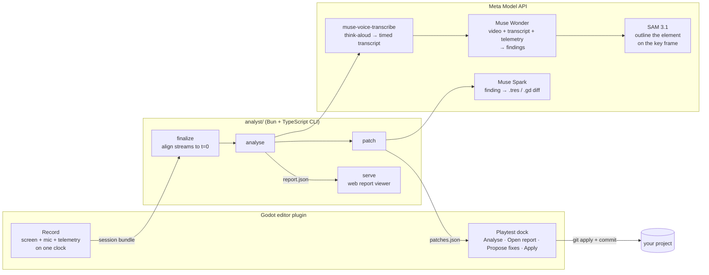

# Playtest Analyst

[](https://github.com/tornupgaming/playtest-analyst/actions/workflows/tests.yml?query=branch%3Amain)
[](LICENSE)
[](https://godotengine.org)
[](https://bun.sh)

An AI UX researcher for solo game developers. A Godot plugin records a playtest (the screen, the player thinking aloud, and gameplay telemetry), Meta's models analyse it, and you get a timestamped report of where the player got confused, stuck or bored. Each finding comes with an annotated key frame and a one-click fix.

[](https://tornupgaming.github.io/playtest-analyst/)

<sub>A **bot-played sample session**, not a real player: a scripted bot plays the test level, which has problems planted in it, and a computer voice reads the think-aloud lines. The selected finding: the EXIT sign points into a dead end, and SAM 3.1 has outlined the sign on the key frame.</sub>

Built for the Meta Global AI Developer Hackathon (Indie developer track), with AI coding agents. Their instructions live in [`CLAUDE.md`](CLAUDE.md) and [`.claude/`](.claude/).

## What you get

- **A list of the moments the player struggled.** Muse Wonder watches the video, reads the think-aloud and the gameplay log, and gives each problem a time, a cause, the player's own words and the evidence.
- **A picture of what to change.** Each finding shows a key frame from the video. When the problem is a thing on screen, such as a sign or an enemy, SAM 3.1 outlines it, if it can find it.
- **A fix you can apply and undo.** Muse Spark writes the fix as a small change to your game's files, and the Godot dock applies it as a git commit.

## See it, try it, read the code

- **See it.** [The sample report, live in your browser](https://tornupgaming.github.io/playtest-analyst/). Nothing to install. Click a finding to jump the video to it.
- **Try it.** The [quick start](#quick-start) opens the same report on your own machine with a handful of commands. You don't need Godot, a mic or an API key.
- **Add it to your game.** [Three steps](#add-it-to-your-game): copy one folder, enable the plugin, point it at the analyst.
- **Read the code.** [`addons/playtest_analyst/`](addons/playtest_analyst/) is the Godot plugin: the recorder and the Playtest dock. [`analyst/src/`](analyst/src/) is the analysis pipeline, a Bun and TypeScript command-line tool that calls Meta's models. For how well it works so far, see [Results so far](#results-so-far) and the [latest evaluation write-up](eval/sweeps/2026-10-27-v2/README.md).

## The problem

Solo developers record friends playing their game, then never watch the footage. Scrubbing hours of video for the moments that matter is a job for a UX researcher they can't afford. Playtest Analyst does that review.

## How it works



1. **Record.** The **Playtest** dock records the game window and the mic with one ffmpeg process, and the `PlaytestTelemetry` autoload logs deaths, retries, zone changes, idle periods and objective updates. All three share one session clock ([docs/recorder.md](docs/recorder.md), [docs/telemetry.md](docs/telemetry.md)).
2. **Analyse.** One Muse Wonder request gets the silent video at 1 fps, the think-aloud as a timestamped transcript (from Meta's ASR, because Wonder places speech it hears 5–245 s off but places what it sees within 2 s), and the telemetry as a timeline. It returns findings, each with a cause (difficulty, pacing, ui or bug), the player's reaction (confused, frustrated, bored or surprised), evidence and a suggested fix ([DECISIONS.md §4](DECISIONS.md)).
3. **Annotate.** For each finding, Muse Wonder names the on-screen element to change, described by how it looks. SAM 3.1 segments it on the key frame, and the report shows the outline.
4. **Fix.** Muse Spark turns each finding into a minimal diff to the files the project allowlists in `playtest.json` (in the sample game, the level's tuning resource). The dock previews the diff and applies it as a `playtest-fix:` commit you can revert.
5. **Compare.** Analyse the next build with `--previous`, and each finding is tagged new or persisting, with the rest listed as resolved.

The session bundle is a plain folder ([DECISIONS.md §2](DECISIONS.md)), so a recorder for another engine would only need to write the same files.

## Add it to your game

The plugin is the [`addons/playtest_analyst/`](addons/playtest_analyst/) folder. The analysis runs outside Godot, from a copy of this repo, so you need both.

1. Clone this repo anywhere, and install the analyst: `cd analyst && bun install`.
2. Copy `addons/playtest_analyst/` into your Godot 4.7 project's `addons/` folder, and enable **Playtest Analyst** in **Project Settings → Plugins**. That adds the **Playtest** dock and the `PlaytestRecorder` and `PlaytestTelemetry` autoloads.
3. Tell the plugin where the analyst is. Add this to your `project.godot`, with the path to `analyst/src/cli.ts` in your clone, either absolute or relative to your project folder:

   ```ini
   [playtest_analyst]

   cli="/home/you/playtest-analyst/analyst/src/cli.ts"
   ```

That's enough to record and analyse. Two optional steps make the report better:

- **Log what happens in your game.** Call `PlaytestTelemetry.event("death", {cause = "fall", zone = "cave"})` and the like, and put the player node in the `player` group. Idle periods are logged for you. The event types are in [docs/telemetry.md](docs/telemetry.md).
- **Allow fixes.** **Propose fixes** may only change files you list in a `playtest.json` at your project root, e.g. `{ "patch_allow": ["tuning/*.tres"] }`. **Apply** commits each fix with git, so the project must be in a git repo (a subfolder of one is fine).

Sessions are saved in `sessions/` inside your project. The videos are large, so you may want `sessions/` in your `.gitignore`. Recording needs Linux; the full list is under [What to install](#what-to-install).

[`sample_game/`](sample_game/) is a complete example: a small Godot game with the plugin installed. Its `addons/playtest_analyst` is a link to the top-level folder, not a copy, so there is only one plugin to edit.

## What to install

What you need depends on how far you go. Each row needs everything in the rows above it.

| To… | Install | Operating system |
|---|---|---|
| See the [live sample report](https://tornupgaming.github.io/playtest-analyst/) | A web browser | Any |
| Open the sample report on your machine ([quick start](#try-it-on-the-sample-session)) | [git](https://git-scm.com), [Bun](https://bun.sh) 1.4 or later, [ffmpeg](https://ffmpeg.org) (the viewer cuts video frames with it), curl and tar | Linux. macOS and Windows not yet tested. |
| Analyse a session again | A Meta Model API key in `META_MODEL_API_KEY` | As above |
| Play the sample game, or add the plugin to your game | [Godot 4.7](https://godotengine.org/download) | Linux. macOS and Windows not yet tested. |
| Record a playtest | ffmpeg with screen capture (x11grab) and mic capture (pulse) built in; an X11 or XWayland desktop; PulseAudio or PipeWire with a working mic | **Linux only.** The dock says so on other systems. |
| Propose and apply fixes | git, with your game's project inside a git repo | Linux. macOS and Windows not yet tested. |
| Rebuild the bot-played sessions (`make_synthetic.sh`) | Python 3 with `venv`, for [Piper](https://github.com/rhasspy/piper) (the script installs Piper itself) | Linux |
| Rebuild the enemy model | [Blender](https://www.blender.org) | Any |

`bun install` fetches the analyst's own libraries, including TypeScript, so there is nothing else to install for its tests and typecheck. The helper scripts in `sample_game/tools/` are bash scripts.

## Quick start

### Try it on the sample session

This needs git, [Bun](https://bun.sh), ffmpeg, curl and tar ([What to install](#what-to-install)). You don't need Godot, a mic or an API key. Git holds only the sample session's text files, so the first step downloads its video, think-aloud audio and key frames (13 MB) from a [GitHub release](https://github.com/tornupgaming/playtest-analyst/releases/tag/sample-planted-voice).

```sh
git clone https://github.com/tornupgaming/playtest-analyst && cd playtest-analyst
curl -fL https://github.com/tornupgaming/playtest-analyst/releases/download/sample-planted-voice/planted-voice-media.tar.gz \
  | tar -xz -C sample_game/sessions/synthetic/planted-voice
cd analyst && bun install
bun src/cli.ts serve ../sample_game/sessions/synthetic/planted-voice    # open the URL it prints; Ctrl+C to stop
```

This opens the report that comes with the repo, the same one as the [live sample](https://tornupgaming.github.io/playtest-analyst/).

To analyse the session again yourself, you need a Meta Model API key. It takes about 2 minutes and costs about $0.30. The new report replaces the bundled one and its key frames.

```sh
export META_MODEL_API_KEY=<your key>
bun src/cli.ts analyse ../sample_game/sessions/synthetic/planted-voice
bun src/cli.ts serve ../sample_game/sessions/synthetic/planted-voice
```

To get the bundled report back (still in `analyst/`):

```sh
git checkout ../sample_game/sessions/synthetic/planted-voice/report.json
curl -fL https://github.com/tornupgaming/playtest-analyst/releases/download/sample-planted-voice/planted-voice-media.tar.gz \
  | tar -xz -C ../sample_game/sessions/synthetic/planted-voice
```

Without a key, `analyse` stops straight away with `META_MODEL_API_KEY is not set` and costs nothing.

### Record your own playtest

This needs Linux and everything in [What to install](#what-to-install) up to the "Record a playtest" row, including a Meta Model API key in `META_MODEL_API_KEY`. For the sample game, `sample_game/tools/preflight.sh` checks all of these, plus spend, level profile, uncommitted changes and disk space ([docs/recorder.md](docs/recorder.md#before-testers-arrive)).

```sh
cd analyst && bun install && cd ..
sample_game/tools/preflight.sh clean  # one PASS or FAIL line per check
godot --path sample_game -e           # open the sample game in the editor; the plugin is already enabled
```

In the **Playtest** dock: **Record session**, play, then F9 or close the window. Then **Analyse** (about 2 minutes and $0.30–0.50 for a 10-minute session), **Open report**, **Propose fixes**, **Apply**.

The same steps from a terminal, for the sample game:

```sh
cd analyst
bun src/cli.ts analyse ../sample_game/sessions/<id>          # report.json, with SAM key frames
bun src/cli.ts serve ../sample_game/sessions/<id>            # prints the viewer URL
bun src/cli.ts export ../sample_game/sessions/<id> <dir>     # the same viewer as a static site, for any web host
bun src/cli.ts patch ../sample_game/sessions/<id> --project ../sample_game
bun src/cli.ts analyse ../sample_game/sessions/<new> --previous ../sample_game/sessions/<id>/report.json
bun src/cli.ts eval ../sample_game/sessions/<id>             # score against eval/ground_truth.json
bun src/cli.ts spend                             # Meta API spend against PLAYTEST_SPEND_CAP_USD
```

Only `planted-voice` has its media in the release. `sample_game/tools/make_synthetic.sh` rebuilds all four bot-played (synthetic) sessions in `sample_game/sessions/synthetic/` from scratch, media included; it needs Godot and [Piper](https://github.com/rhasspy/piper) for the voice.

## Meta models used

| Model | What it does here |
|---|---|
| Muse Wonder (`muse-wonder-1.0`) | Watches the session video with the transcript and telemetry, and writes the findings. Compares builds. |
| Muse Voice Transcribe (`muse-voice-transcribe-1.0`) | Turns the think-aloud into turns with start and end times, so quotes land on the right moment. |
| SAM 3.1 (`sam-3.1`) | Segments the element each finding is about on its key frame. |
| Muse Spark (`muse-spark-1.3`) | Writes the fix as a diff to an allowlisted project file. |

What we measured about each one is in the [wiki](docs/wiki/index.md).

## Results so far

These numbers come from **synthetic sessions**, recorded with no human: a scripted bot plays the test course, and Piper TTS, a computer voice, speaks think-aloud lines ([eval/sweeps/2026-10-26-synthetic](eval/sweeps/2026-10-26-synthetic/README.md)). The voice lines were written from the answer key, so treat these as a smoke test. Real playtests come next.

The test course has 6 **planted problems**: spots we made hard, slow or misleading on purpose, such as an EXIT sign that points into a dead end. An answer key ([`eval/ground_truth.json`](eval/ground_truth.json)) records each one, so a report can be scored. **Recall** is the share of planted problems a report finds. **Strict scoring** counts a find only when the report also gives it the same category as the key, such as `difficulty` or `ui`. The **prompt** is the written instructions Muse Wonder gets; we number its versions v0, v1 and v2.

- In every configuration tried, Muse Wonder located all 6 planted problems on the voiced session, and 5–6 of 6 with no voice at all.
- At strict scoring (right place and right category), prompt v2 gets recall 1.00 and 0.92 over two runs (12 of 12, then 11 of 12), the same as when the category is ignored ([eval/sweeps/2026-10-27-v2](eval/sweeps/2026-10-27-v2/README.md)). Before v2, strict recall was 0.50–0.75, and almost every loss was a problem that the report labelled `confusion` and the answer key labelled `ui`, or the other way round. v2 labels the cause (what to change) and records the player's feeling separately ([DECISIONS.md §6](DECISIONS.md#6-eval)).
- No false positives in 32 runs: every finding was one of the planted problems, and the clean (fixed) level produced none.
- Cost: about $0.30 per 3-minute session; latency 1–2 minutes.


## Layout

| Path | What it is |
|---|---|
| `addons/playtest_analyst/` | **The plugin**, the folder you copy into your game: the Playtest dock, the `PlaytestRecorder` autoload that records a session bundle ([docs/recorder.md](docs/recorder.md)), and the `PlaytestTelemetry` autoload ([docs/telemetry.md](docs/telemetry.md)). |
| `analyst/` | **The analysis CLI** (`bun src/cli.ts <command>`): finalize, analyse, annotate, patch, eval, sweep, serve, export. Shared schemas in `src/schema.ts`. |
| `sample_game/` | **The sample game**, a Godot project with the plugin installed (`addons/playtest_analyst` links to the top-level folder). Open it with `godot --path sample_game -e`. |
| `sample_game/level/` | The test course (`level.tscn`). It reads every tunable from `level/tuning.tres` at `_ready()`. |
| `sample_game/profiles/` | The two tuning profiles, planted and clean (see [Test course](#test-course)). |
| `sample_game/demo/` | Player and enemy. The player's movement code comes from the Godot 3D platformer demo (see Credits). |
| `sample_game/art/` | Kenney Platformer Kit models (`art/kenney/`), the toy-block shader and its materials (`art/blocks/`), the enemy and the Blender script that builds it (`art/enemy/`), and the HUD font. |
| `sample_game/tests/` | GDScript tests of the plugin, run headless by `sample_game/tools/test.sh`. |
| `sample_game/tools/` | Scripts for checking the level without playing it (see [Checking the level](#checking-the-level)), the synthetic-session bot (`make_synthetic.sh`), the test runners, and `preflight.sh`, run before testers arrive. |
| `sample_game/sessions/` | Session bundles. Media is gitignored; `sessions/synthetic/` holds the bot-played sessions. |
| `sample_game/playtest.json` | Which files **Propose fixes** may change in the sample game. |
| `eval/` | The answer key for the sample game's planted problems, and past evaluation runs (`eval/sweeps/`). It is outside the Godot project, so its labels never reach a recording. |
| `tools/` | `publish_pages.sh`, which puts a session's report on GitHub Pages as the live sample. |
| `docs/` | The demo script, recorder and telemetry docs, and the [wiki](docs/wiki/index.md) of measured facts about the APIs. |
| [`spikes/`](spikes/README.md) | Throwaway experiments behind each decision in [DECISIONS.md](DECISIONS.md), with an index of the question each one answered. |

## Test course

Open `sample_game/` in Godot 4.7 and press Play. Pick a profile by copying it over the live tuning file:

```sh
cp sample_game/profiles/tuning_planted.tres sample_game/level/tuning.tres   # with the planted problems
cp sample_game/profiles/tuning_clean.tres sample_game/level/tuning.tres     # baseline: the problems fixed
```

`eval/ground_truth.json` lists what differs between the profiles and the evidence each difference should leave.

To record a playtest, use the **Playtest** dock in the editor ([docs/recorder.md](docs/recorder.md)).

Controls: WASD or arrows to move, Space to jump. Click to capture the mouse, then move it to orbit the camera (Esc releases it). Jump on the enemy to squash it.

### Art direction

Bright toybox platformer, in the family of Super Mario 3D World, Captain Toad and Astro Bot. Grass-topped clay cliffs and floating mesas over a sea of cloud, chunky bevelled blocks, a soft checker on walkable tops so distances read at a glance, saturated colours under a warm sun. Everything uses the Kenney Platformer Kit palette.

The level is still built from boxes in `level.gd`, so every planted problem keeps its exact geometry. `sample_game/art/blocks/block.gdshader` makes any box look like a Kenney block. Each block kind (grass, sand, stone, wood, hedge) is a material in `sample_game/art/blocks/`, editable in the inspector.

To rebuild the enemy after editing its script:

```sh
blender -b -P sample_game/art/enemy/build_enemy.py -- sample_game/art/enemy/enemy.glb /tmp/enemy_preview.png
```

## Checking the level

These run the real game from the command line and write images, so a change can be checked without playing it.

```sh
cd sample_game
tools/check.sh                      # build both profiles headless; fails on script errors or z-fighting blocks
tools/test.sh                       # GDScript tests in tests/ (telemetry, patch apply), headless
tools/record_check.sh 60            # record a real 60 s session with a loopback mic; check the bundle and mic lag
tools/shots.sh                      # every named view -> /tmp/shots/sheet.png (one labelled contact sheet)
tools/shots.sh -p planted beacon    # one view, planted profile
tools/shots.sh over=50,70,30:0,0,-90                   # a free camera: name=eye:target
tools/clip.sh -v drop "move_forward+jump:0.7,:1"       # scripted input -> /tmp/shots/clip_strip.png and clip.mp4
tools/clip.sh -c 0,3,-14 "move_right:1,move_left:1"   # the same, filmed from a fixed point
tools/footage.sh                    # the demo video's shots with no players -> /tmp/footage (1080p mp4 + PNG stills)
```

They work from any folder and run `godot` from your PATH. To use another Godot 4.7 binary, set `GODOT`, e.g. `GODOT=~/bin/godot-4.7 tools/test.sh`. GitHub runs `tools/test.sh` and `tools/check.sh`, plus the analyst's tests and typecheck, on every pull request and every push to `main`.

Views are defined in `VIEWS` in `sample_game/tools/shot.gd`: the player stands at an offset into a zone and the game camera frames it, so a shot shows what a tester sees. `clip.sh` prints where the player ended up. A player at the spawn after a run means they died.

## Credits

- **Godot platformer demo.** The player's movement code, the enemy's charge logic and the sounds in `sample_game/demo/` come from [godotengine/godot-demo-projects `3d/platformer`](https://github.com/godotengine/godot-demo-projects/tree/master/3d/platformer) (commit `b761b4c`), © the Godot Engine contributors, MIT licence (`sample_game/demo/LICENSE.md`). We replaced its models, camera, shooting and sky. The level handles respawns, and the enemy waits to be triggered, charges, kills on contact, and dies when stomped.
- **Kenney.** Models in `sample_game/art/kenney/` come from the [Platformer Kit](https://kenney.nl/assets/platformer-kit) by Kenney (www.kenney.nl), CC0 (`sample_game/art/kenney/License.txt`).
- **Fredoka.** The HUD font, © The Fredoka Project Authors, SIL Open Font License 1.1 (`sample_game/art/fonts/OFL.txt`).
- **Inter.** The report viewer's text font, © The Inter Project Authors, SIL Open Font License 1.1 (`analyst/viewer/fonts/Inter-OFL.txt`).
- The enemy model and the block shader are our own.
