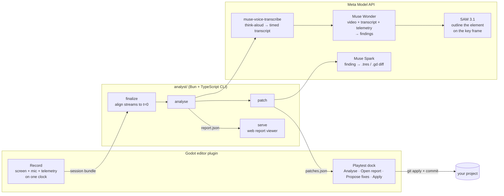

# Playtest Analyst

An AI UX researcher for solo game developers. A Godot plugin records a playtest (the screen, the player thinking aloud, and gameplay telemetry), Meta's models analyse it, and you get a timestamped report of where the player got confused, stuck or bored. Each finding comes with an annotated key frame and a one-click fix.

Built for the Meta Global AI Developer Hackathon (Indie developer track).

**[See a sample report in your browser](https://tornupgaming.github.io/playtest-analyst/)**, no install needed. It is a bot-played session of the test level with planted problems and a scripted think-aloud, analysed by Meta's models: click a finding to jump the video to it.

## The problem

Solo developers record friends playing their game, then never watch the footage. Scrubbing hours of video for the moments that matter is a job for a UX researcher they can't afford. Playtest Analyst does that review.

## How it works



1. **Record.** The **Playtest** dock records the game window and the mic with one ffmpeg process, and the `PlaytestTelemetry` autoload logs deaths, retries, zone changes, idle periods and objective updates. All three share one session clock ([docs/recorder.md](docs/recorder.md), [docs/telemetry.md](docs/telemetry.md)).
2. **Analyse.** One Muse Wonder request gets the silent video at 1 fps, the think-aloud as a timestamped transcript (from Meta's ASR, because Wonder places speech it hears 5–245 s off but places what it sees within 2 s), and the telemetry as a timeline. It returns findings, each with a cause (difficulty, pacing, ui or bug), the player's reaction (confused, frustrated, bored or surprised), evidence and a suggested fix ([DECISIONS.md §4](DECISIONS.md)).
3. **Annotate.** For each finding, Muse Wonder names the on-screen element to change, described by how it looks. SAM 3.1 segments it on the key frame, and the report shows the outline.
4. **Fix.** Muse Spark turns each finding into a minimal diff to the files the project allowlists (here, the level's tuning resource). The dock previews the diff and applies it as a `playtest-fix:` commit you can revert.
5. **Compare.** Analyse the next build with `--previous`, and each finding is tagged new or persisting, with the rest listed as resolved.

The session bundle is a plain folder ([DECISIONS.md §2](DECISIONS.md)), so a recorder for another engine would only need to write the same files.

## Quick start

Needs Godot 4.7, [Bun](https://bun.sh), ffmpeg with x11grab and PulseAudio input, Linux with X11 or XWayland, PulseAudio or PipeWire with a working mic, and a Meta Model API key in `META_MODEL_API_KEY`. `tools/preflight.sh` checks all of these, plus spend, level profile, uncommitted changes and disk space ([docs/recorder.md](docs/recorder.md#before-testers-arrive)).

```sh
cd analyst && bun install && cd ..
tools/preflight.sh clean              # one PASS or FAIL line per check
godot --path . -e                     # open the editor; the plugin is already enabled
```

In the **Playtest** dock: **Record session**, play, then F9 or close the window. Then **Analyse** (about 2 minutes and $0.30–0.50 for a 10-minute session), **Open report**, **Propose fixes**, **Apply**.

The same steps from a terminal:

```sh
cd analyst
bun src/cli.ts analyse ../sessions/<id>          # report.json, with SAM key frames
bun src/cli.ts serve ../sessions/<id>            # prints the viewer URL
bun src/cli.ts export ../sessions/<id> <dir>     # the same viewer as a static site, for any web host
bun src/cli.ts patch ../sessions/<id> --project ..
bun src/cli.ts analyse ../sessions/<new> --previous ../sessions/<id>/report.json
bun src/cli.ts eval ../sessions/<id>             # score against eval/ground_truth.json
bun src/cli.ts spend                             # Meta API spend against PLAYTEST_SPEND_CAP_USD
```

To try it without playing, `tools/make_synthetic.sh` builds four bot-played sessions of the test course in `sessions/synthetic/`.

## Meta models used

| Model | What it does here |
|---|---|
| Muse Wonder (`muse-wonder-1.0`) | Watches the session video with the transcript and telemetry, and writes the findings. Compares builds. |
| Muse Voice Transcribe (`muse-voice-transcribe-1.0`) | Turns the think-aloud into turns with start and end times, so quotes land on the right moment. |
| SAM 3.1 (`sam-3.1`) | Segments the element each finding is about on its key frame. |
| Muse Spark (`muse-spark-1.3`) | Writes the fix as a diff to an allowlisted project file. |

What we measured about each one is in the [wiki](docs/wiki/index.md).

## Results so far

These numbers come from **synthetic** sessions: a scripted bot plays the test course, and Piper TTS speaks think-aloud lines ([eval/sweeps/2026-10-26-synthetic](eval/sweeps/2026-10-26-synthetic/README.md)). The voice lines were written from the answer key, so treat these as a smoke test. Real playtests come next.

- In every configuration tried, Muse Wonder located all 6 planted problems on the voiced session, and 5–6 of 6 with no voice at all.
- At strict scoring (right place and right category), prompt v2 gets recall 1.00 and 0.92 over two runs, the same as when the category is ignored ([eval/sweeps/2026-10-27-v2](eval/sweeps/2026-10-27-v2/README.md)). Before v2, strict recall was 0.50–0.75, and almost every loss was a problem labelled `confusion` in one place and `ui` in the other. v2 labels the cause (what to change) and records the player's feeling separately (TUG-125).
- No false positives in 32 runs: every finding was one of the planted problems, and the clean (fixed) level produced none.
- Cost: about $0.30 per 3-minute session; latency 1–2 minutes.


## Layout

| Path | What it is |
|---|---|
| `analyst/` | The analysis CLI (`bun src/cli.ts <command>`): finalize, analyse, annotate, patch, eval, sweep, serve, export. Shared schemas in `src/schema.ts`. |
| `addons/playtest_analyst/` | The plugin: the Playtest dock, the `PlaytestRecorder` autoload that records a session bundle ([docs/recorder.md](docs/recorder.md)), and the `PlaytestTelemetry` autoload ([docs/telemetry.md](docs/telemetry.md)). |
| `tests/` | GDScript tests, run headless by `tools/test.sh`. |
| `level/` | The test course (`level.tscn`). It reads every tunable from `level/tuning.tres` at `_ready()`. |
| `eval/` | Ground truth and the two tuning profiles. Godot ignores this folder (`.gdignore`), so its labels never reach the analysis. |
| `demo/` | Player and enemy. The player's movement code comes from the Godot 3D platformer demo (see Credits). |
| `art/` | Kenney Platformer Kit models (`art/kenney/`), the toy-block shader and its materials (`art/blocks/`), the enemy and the Blender script that builds it (`art/enemy/`), and the HUD font. |
| `tools/` | Scripts for checking the level without playing it (see [Checking the level](#checking-the-level)), the synthetic-session bot (`make_synthetic.sh`), the test runners, and `preflight.sh`, run before testers arrive. |
| `sessions/` | Session bundles. Media is gitignored; `sessions/synthetic/` holds the bot-played sessions. |
| `docs/` | The demo script, recorder and telemetry docs, and the [wiki](docs/wiki/index.md) of measured facts about the APIs. |
| `spikes/` | Throwaway experiments behind each decision in [DECISIONS.md](DECISIONS.md). |

## Test course

Open the project in Godot 4.7 and press Play. Pick a profile by copying it over the live tuning file:

```sh
cp eval/tuning_planted.tres level/tuning.tres   # round 1
cp eval/tuning_clean.tres level/tuning.tres     # baseline
```

`eval/ground_truth.json` lists what differs between the profiles and the evidence each difference should leave.

To record a playtest, use the **Playtest** dock in the editor ([docs/recorder.md](docs/recorder.md)).

Controls: WASD or arrows to move, Space to jump. Click to capture the mouse, then move it to orbit the camera (Esc releases it). Jump on the enemy to squash it.

### Art direction

Bright toybox platformer, in the family of Super Mario 3D World, Captain Toad and Astro Bot. Grass-topped clay cliffs and floating mesas over a sea of cloud, chunky bevelled blocks, a soft checker on walkable tops so distances read at a glance, saturated colours under a warm sun. Everything uses the Kenney Platformer Kit palette.

The level is still built from boxes in `level.gd`, so every plant keeps its exact geometry. `art/blocks/block.gdshader` makes any box look like a Kenney block. Each block kind (grass, sand, stone, wood, hedge) is a material in `art/blocks/`, editable in the inspector.

To rebuild the enemy after editing its script:

```sh
blender -b -P art/enemy/build_enemy.py -- art/enemy/enemy.glb /tmp/enemy_preview.png
```

## Checking the level

These run the real game from the command line and write images, so a change can be checked without playing it.

```sh
tools/check.sh                      # build both profiles headless; fails on script errors or z-fighting blocks
tools/test.sh                       # GDScript tests in tests/ (telemetry, patch apply), headless
tools/record_check.sh 60            # record a real 60 s session with a loopback mic; check the bundle and mic lag
tools/shots.sh                      # every named view -> /tmp/shots/sheet.png (one labelled contact sheet)
tools/shots.sh -p planted beacon    # one view, planted profile
tools/shots.sh over=50,70,30:0,0,-90                   # a free camera: name=eye:target
tools/clip.sh -v drop "move_forward+jump:0.7,:1"       # scripted input -> /tmp/shots/clip_strip.png and clip.mp4
tools/clip.sh -c 0,3,-14 "move_right:1,move_left:1"   # the same, filmed from a fixed point
```

Views are defined in `VIEWS` in `tools/shot.gd`: the player stands at an offset into a zone and the game camera frames it, so a shot shows what a tester sees. `clip.sh` prints where the player ended up. A player at the spawn after a run means they died.

## Credits

- **Godot platformer demo.** The player's movement code, the enemy's charge logic and the sounds in `demo/` come from [godotengine/godot-demo-projects `3d/platformer`](https://github.com/godotengine/godot-demo-projects/tree/master/3d/platformer) (commit `b761b4c`), © the Godot Engine contributors, MIT licence (`demo/LICENSE.md`). We replaced its models, camera, shooting and sky. The level handles respawns, and the enemy waits to be triggered, charges, kills on contact, and dies when stomped.
- **Kenney.** Models in `art/kenney/` come from the [Platformer Kit](https://kenney.nl/assets/platformer-kit) by Kenney (www.kenney.nl), CC0 (`art/kenney/License.txt`).
- **Fredoka.** The HUD font, © The Fredoka Project Authors, SIL Open Font License 1.1 (`art/fonts/OFL.txt`).
- The enemy model and the block shader are our own.
