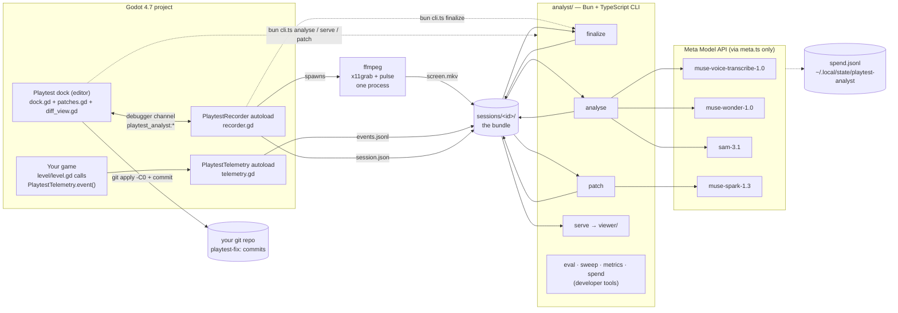
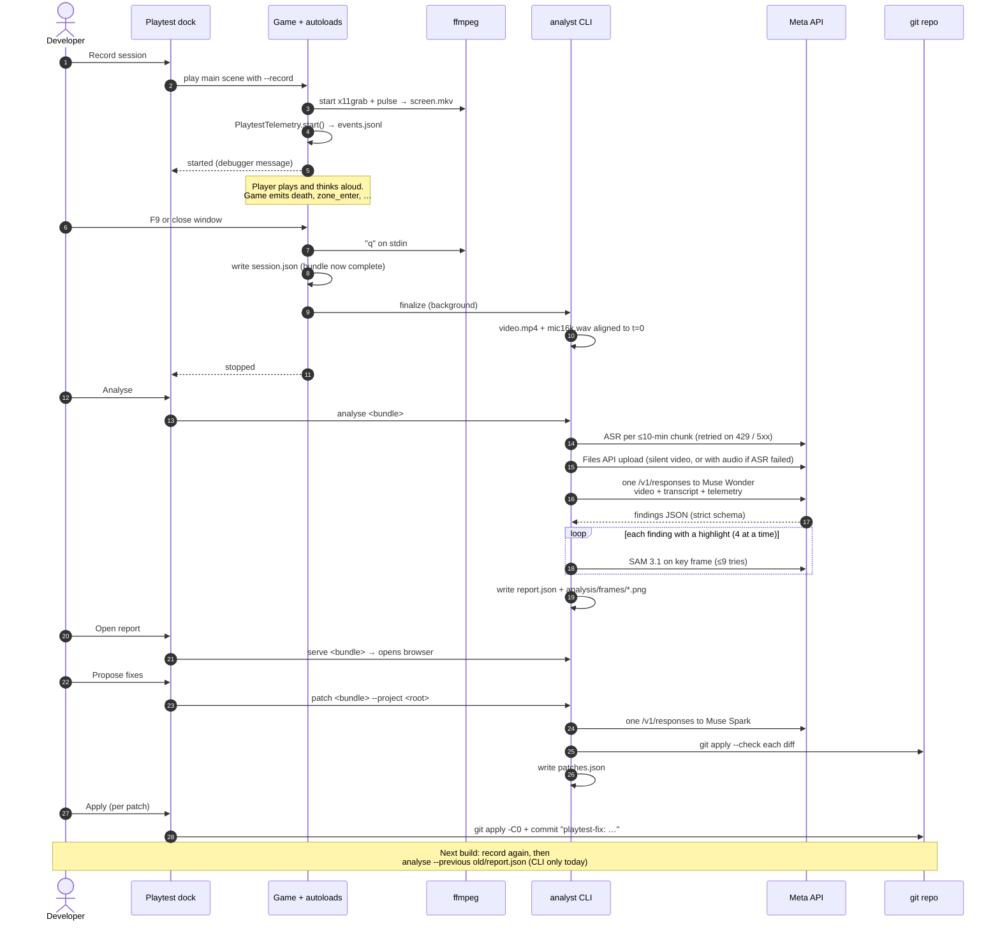
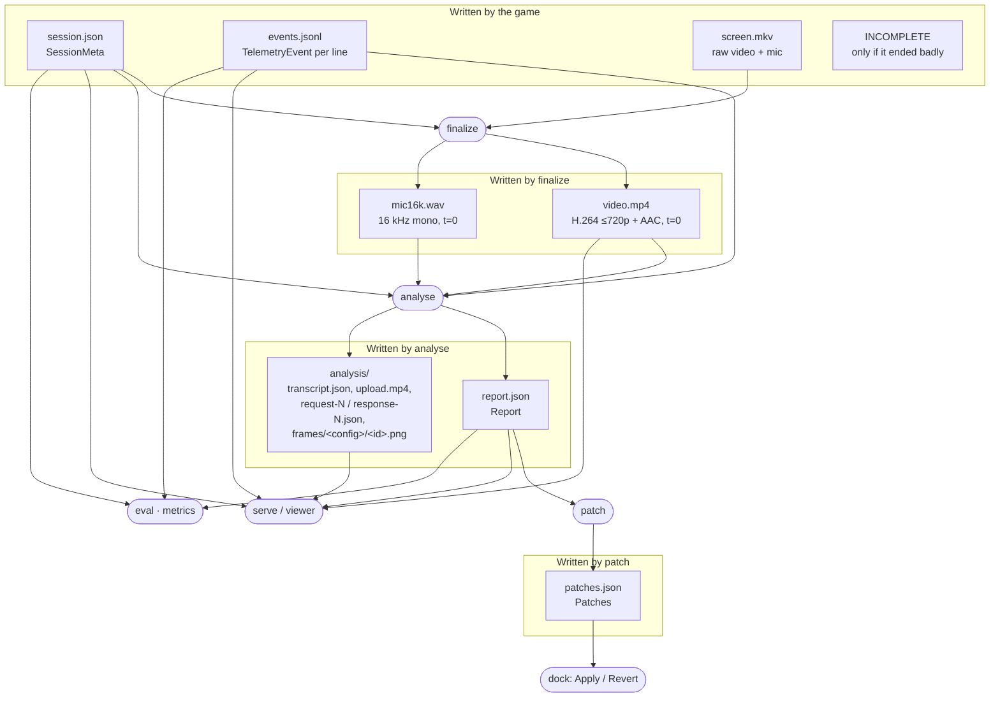
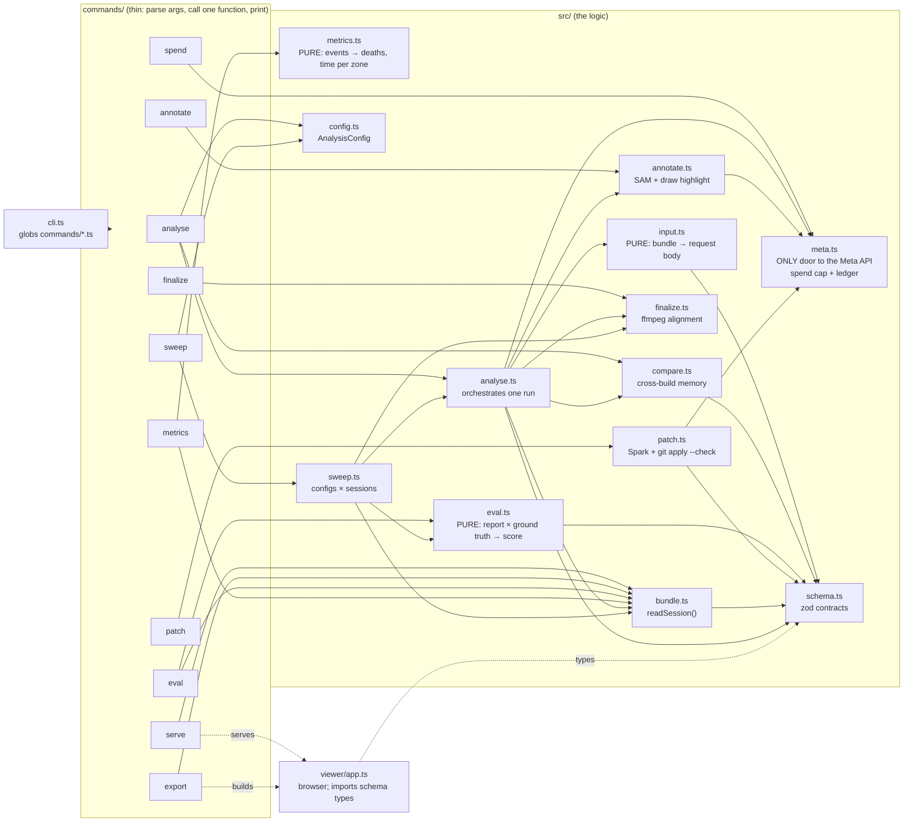
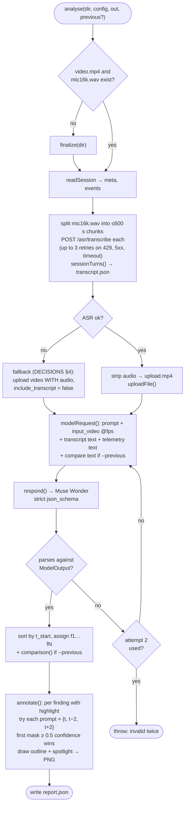
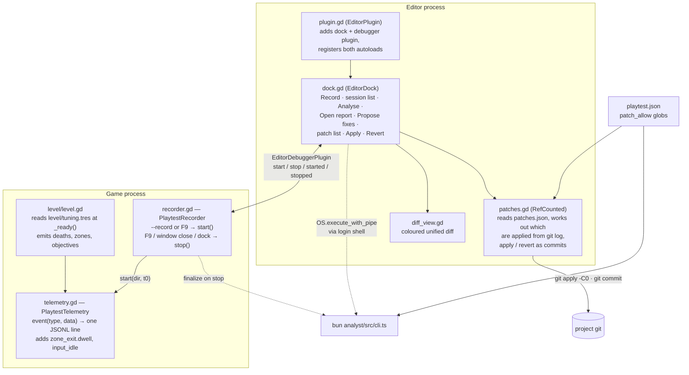
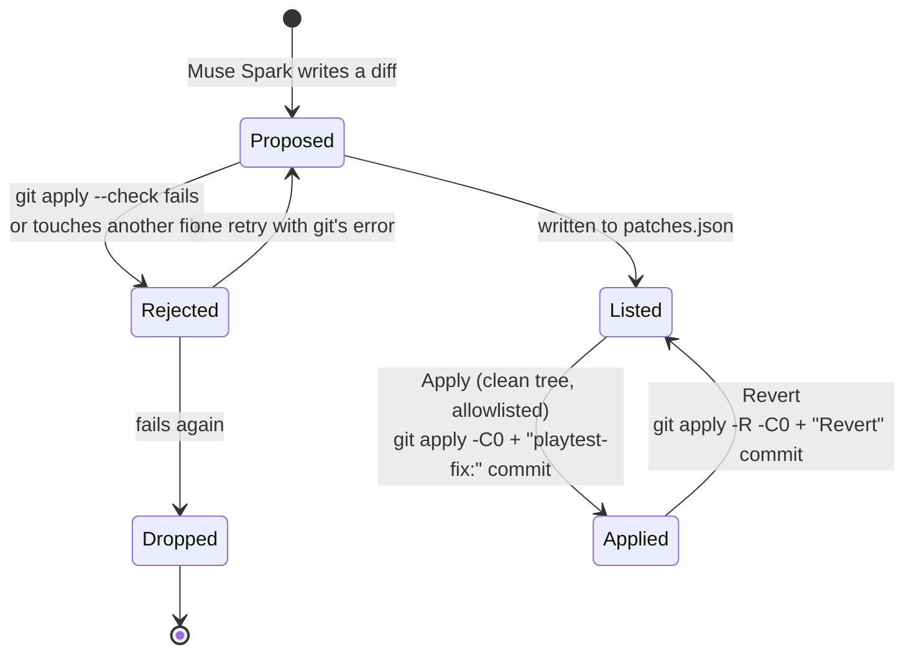
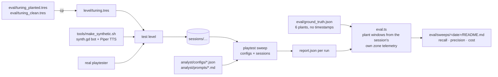
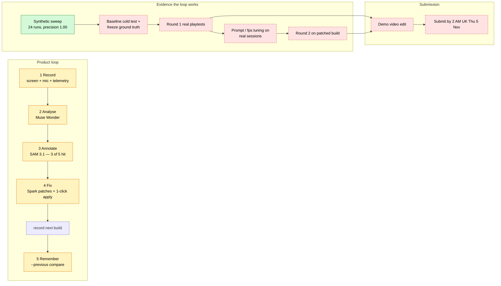

# How the system works

This guide sits a level below the README. It explains what each piece of code does, what it reads and writes, and how a session moves through the system. It also covers what is built today and what the end state looks like. File references point at the code, so you can jump from a diagram to the code it describes.

Two rules shape everything:

1. **The session bundle is the contract** ([DECISIONS.md §2](../DECISIONS.md)). Godot writes a folder, and everything after that reads only the folder.
2. **One clock.** `t` is seconds since the recorder started. `finalize` moves every stream onto that clock once, so nothing downstream does clock maths.

---

## 1. The big picture (current state)

**What runs where**

| Process | Code | Lifetime |
|---|---|---|
| Godot editor | `addons/playtest_analyst/plugin.gd`, `dock.gd` | While the editor is open |
| The game being playtested | `recorder.gd`, `telemetry.gd` (autoloads) + your game | One session |
| ffmpeg recorder | spawned by `recorder.gd` with a watchdog shell wrapper | One session; stopped with `q` on stdin |
| `bun analyst/src/cli.ts <cmd>` | `analyst/src/commands/*.ts` | One command; `serve` runs until killed |
| Viewer | `analyst/viewer/` in the browser, served by `serve` | While the tab is open |

The dock and the recorder never call each other directly. They talk over Godot's **debugger channel**: the dock is an `EditorDebuggerPlugin`, and the game sends `playtest_analyst:started` / `stopped` messages back. Every CLI call from Godot goes through the user's **login shell** (`recorder.gd` → `cli_command()`), so it picks up `META_MODEL_API_KEY` from `~/.zshenv`.

---

## 2. One session, end to end

---

## 3. The bundle: who writes and who reads each file

Every arrow into the CLI goes through a zod parser in `analyst/src/schema.ts`. That file is the one place to look up a file's shape. `bundle.ts → readSession()` is the boundary for `session.json` and `events.jsonl`, and it sorts events by `t` once, because `input_idle` lines are written late.

---

## 4. The analyst CLI: modules and dependencies

How to read it:

- **`commands/` are shells.** Each exports `description` and `run(argv)`. To add a command, drop in a new file; `cli.ts` finds it with a glob.
- **The pure modules** are `input.ts`, `eval.ts`, `metrics.ts`, and `comparison()` in `compare.ts`. Data goes in and data comes out, so this is where the unit tests live (`*.test.ts`).
- **`meta.ts` is the only way out to the network.** `respond()` (Responses API), `uploadFile()` (Files API) and `metaFetch()` (ASR) all check the spend cap before the call and append to the ledger after it. `metaFetch()` retries a rate limit (429), a server error (5xx) or a timeout 3 times, 2, 4 then 8 s apart; the OpenAI SDK retries the other two itself. SAM goes through `respond()` too and is billed per image.
- **Configs** (`analyst/configs/*.json`) are plain data: prompt file, fps, and whether to include the transcript or telemetry. `sweep` runs every config on every session, so prompt changes can be compared.

---

## 5. Inside `analyse()`

`analyst/src/analyse.ts`

The validation error from attempt 1 is appended to the prompt for attempt 2. `patch` does the same when Muse Spark's answer doesn't match its schema. In compare mode, the output schema narrows `previous_id` to an enum of the previous report's ids, so the model can't make up a match.

---

## 6. The Godot side

`playtest.json` is read on both sides of the patch flow. `patch.ts` limits Muse Spark to the allowlisted files, and `patches.gd` checks the allowlist again before it applies a diff. It has to, because `patches.json` is model output read from disk.

### Lifecycle of one patch

The dock works out whether a patch is applied from **git history** (`playtest-fix:` commits that haven't been reverted). It stores no state of its own, so the state can't drift from the repo.

---

## 7. The developer loop: measuring the analyser

This loop isn't part of the product. It's how prompts and configs get tuned against a known answer key. The test level has six **planted problems** ("plants"): spots we made hard, slow or misleading on purpose. The answer key lists them, and **synthetic sessions**, where a scripted bot plays the level and Piper TTS reads think-aloud lines, give the loop something to score without a human player.

`eval/` has a `.gdignore`, so Godot never imports the answer key, and the key can't end up in a recording.

---

## 8. Current state vs end state

What the CLAUDE.md brief asked for, against what the code does today and what was still open (as of 27 Oct). Round 1 is the first set of real playtests, on the level with its planted problems; round 2 is the next set, on the build after the suggested fixes are applied.

Key: green = done; amber = built, in review; red dashed = not started.

### The gaps, concretely

| Area | Today | End state | Where the change would go |
|---|---|---|---|
| Evidence | Synthetic bot sessions, whose voice lines were written from the answer key, plus one think-aloud run by the developer. | Real round 1 and round 2 playtests, scored by `eval` | `sessions/`, `eval/sweeps/` |
| Ground truth | `frozen_at` not set yet | Frozen after the cold test, before any real analysis | `eval/ground_truth.json` |
| Annotation | Decided: keep SAM, with a plain frame when nothing matches. On the developer's own think-aloud run, all 3 highlights asked for landed on the right object. On synthetic planted-voice, 3 of 5 matched, one of them on the wrong platform | Done | `annotate.ts`, prompt `highlight` guidance |
| Remember | CLI flag only (`analyse --previous … --patches …`); the viewer shows the banner and chips | The demo video uses the comparison banner, if it ships | `dock.gd` would need a "compare with" picker |
| Metrics | `playtest metrics` is CLI only | Before/after table for the demo video | Captured from the CLI; no dock work needed |
| Platform | Linux + X11/XWayland only | Same for the hackathon (DECISIONS §3 limit) | `recorder.gd → _ffmpeg_args()` for other OSes |

On the product side, all five stages from the brief are now built, including both stretch goals. Every amber box is code waiting on review, not missing code. Between today and the end state the remaining work is **evidence and submission**: real playtests, tuning against them, and the video.
